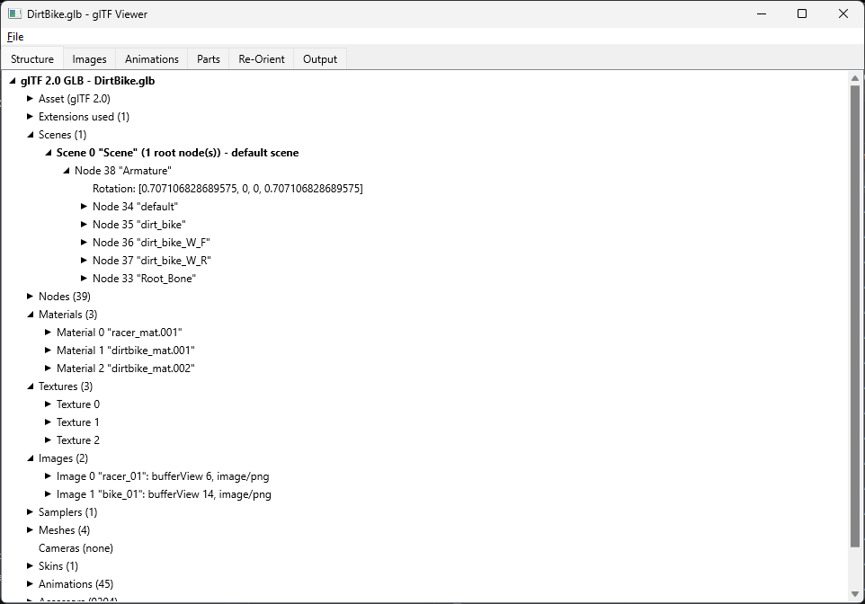

# GLTFMerge

A Delphi library and FireMonkey application for reading, inspecting, editing and writing
glTF 2.0 models (`.gltf` and `.glb`), and for merging them together.



## What it does

GLTFMerge opens a base model and lets you add the things that often come in separate files,
then saves the result as one model.

- **Merge animations.** Models and animations are frequently shipped apart, especially when
  many models share one skeleton. Open the model, go to the **Animations** tab and import as
  many animation files as you like. Everything is ticked for export by default; use **Export
  none** and tick only the ones you want if you need a subset. Save, and you have one model
  with exactly those animations. The same trick makes a small file holding just the part of a
  large animation library your project needs.
- **Add parts.** Optional body parts, clothes or other pieces made for a model can be loaded
  on the **Parts** tab, ticked and put on with **Put on ticked parts**; the body underneath is
  hidden where the parts cover it. The merged model can then be saved.
- **Re-orient.** Models exported with the wrong up or forward axis for your engine can be
  turned about X, Y and Z when saved, with the turn baked into the data.
- **Clean up.** Leave out animations, images no mesh uses, and EXIF data in images.

Saving only ever writes what is in the objects. The loaded model is never changed by a save,
so you can try different settings and save again.

## The application

The viewer has a **File** menu and six tabs. The window title shows the model loaded, with a
`*` while there are changes not yet saved.

| Tab | What it is for |
| --- | --- |
| **Structure** | The whole document as a tree: scenes, nodes, meshes, materials, textures, images, skins, animations, accessors and more. |
| **Images** | Every image with its type, source, size and status, and whether a mesh uses it. Locate missing image files, choose per image whether it is stored inside the file or next to it, and tick **Don't save EXIF data**. |
| **Animations** | Every animation with its origin, channels and length. Tick which are saved, import more from other files, rename one by clicking its name, clear them all, or split one long animation into named frame ranges. |
| **Parts** | Load part files, put the ticked parts on the model and take them off again, with settings for how much of the body they hide. |
| **Re-Orient** | The turn about X, Y and Z applied when saving, with presets for Z-up to Y-up, Y-up to Z-up, facing the other way, flipping upside down and no turn. |
| **Output** | A log of loading, saving and everything done to the model, with errors shown at their line in the glTF text. |

### File menu

- **Open...** loads a `.gltf` or `.glb` file. Missing images or buffers are offered for
  locating after the load.
- **Save As...** saves as GLB (the default) or glTF. A GLB holds its images; a glTF writes them
  as files next to it. Every file the saved model refers to is written or copied next to it.
  An image file never overwrites a different file already there.
- **Bulk Re-Orient...** turns every model in a folder and its sub-folders and saves the copies
  in another folder with the same sub-folders. You choose the input folder, whether to convert
  GLB, glTF or both, the output folder, the format to save as and the turn. The input files
  are never changed.
- **Exit** asks first, with OK and Cancel, while there are unsaved changes, as do closing the
  window and opening another file.

### Splitting long animations

Some files hold every animation joined into one long take, such as `Take001`. While an
animation is longer than 10 seconds, **Split long animation...** appears on the Animations
tab. It opens a sheet where each row is a name, a start frame and an end frame, with:

- the frame rate (30 by default) and the last frame, either of which can be typed in;
- an optional check that frames increase from row to row;
- **Import list...**, which reads the ranges from the text file that often comes with
  animation packs, in most of the layouts those files use;
- **Save sheet...** and **Load sheet...** to finish a sheet later.

### Settings

Settings are kept between sessions in `settings.json`, in the place each platform expects:

| Platform | Folder |
| --- | --- |
| Windows | `%APPDATA%\glTFMerge` |
| macOS | `~/Library/Application Support/glTFMerge` |
| Linux | `$XDG_CONFIG_HOME/glTFMerge`, else `~/.config/glTFMerge` |
| iOS, Android | the app's own folders |

Every file dialog remembers its own folder, so opening, saving, importing animations and so on
each start where they were last used. The EXIF choice and the Bulk Re-Orient choices are
remembered too.

## Getting started

### Requirements

- Delphi 10.4 or later, with FireMonkey.
- [Neon](https://github.com/paolo-rossi/delphi-neon), the JSON library, included as a git
  submodule in `delphi-neon`.
- For Linux, FMXLinux.

The application targets Windows, macOS, Linux, iOS and Android. On iOS and Android, where
FireMonkey has no file dialogs, a built-in file browser is used, and the File menu is shown in
a menu bar at the top of the window.

### Getting the code

Clone with the submodule:

```
git clone --recurse-submodules https://github.com/G3DGames/GLTFMerge.git
```

or, in a copy cloned without it:

```
git submodule init
git submodule update
```

### Building

Open `glTFMerge.dproj` (or the group `GLTFFileManipulation.groupproj`) in Delphi, choose a
platform and build. Memory leaks are reported when the application closes.

### Command line

On the desktop the application takes an optional file to open:

```
glTFMerge [file.gltf | file.glb] [--selftest]
```

### Self-tests

The self-tests are left out of normal builds. To build them in, remove the `//` in front of
`{$DEFINE SELF_TESTS}` near the top of `src/glTFViewer.Main.pas`. The File menu then has
**Run self-tests**, and `--selftest` on the command line runs them. They use small models
built in memory, not the file loaded, and report each test as PASS or FAIL on the Output tab.

## Project layout

```
glTFMerge.dpr       the application
GLTFLib/            the library: no user interface
src/                the application's forms and frames, each designed in an .fmx file
delphi-neon/        the Neon JSON library (submodule)
docs/lib, docs/ui   PasDoc documentation of the library and of the application
img/                images for this file
```

### The library

The units in `GLTFLib` work without the application and can be used on their own.

| Unit | Purpose |
| --- | --- |
| `glTF.Base`, `glTF.Classes` | The glTF 2.0 object model, with extensions and extras kept. |
| `glTF.SourceMap` | Line and column of every JSON value, for error messages. |
| `glTF.Document` | `TglTFDocument`: load and save `.gltf` and `.glb`, find missing files, progress reports. |
| `glTF.Edit` | Editing helpers: delete unused data, images in use, clear animations, rename animations. |
| `glTF.Animations` | Import animations from other files onto a model's skeleton. |
| `glTF.AnimationSplit` | Split one animation into frame ranges; read range lists from text. |
| `glTF.Parts` | Load parts and put them on a model, hiding the body they cover. |
| `glTF.Orient` | Turn a whole model about X, Y and Z, baked into its data. |
| `glTF.Bulk` | Re-orient every model in a folder tree. |
| `glTF.Exif` | Remove EXIF data from JPEG, PNG and WebP images. |

For example, to merge animations into a model and save it turned to Y-up without EXIF data:

```pascal
uses
  glTF.Document, glTF.Animations;

var
  LDoc: TglTFDocument;
  LImporter: TglTFAnimationImporter;
  LOptions: TglTFSaveOptions;
begin
  LDoc := TglTFDocument.Create;
  try
    LDoc.LoadFromFile('character.glb');

    LImporter := TglTFAnimationImporter.Create(LDoc);
    try
      LImporter.ImportFiles(['walk.glb', 'run.glb']);
    finally
      LImporter.Free;
    end;

    LOptions := TglTFSaveOptions.Default;
    LOptions.RotateX := -90;     // Z-up to Y-up
    LOptions.StripExif := True;
    LDoc.SaveToFile('character_animated.glb', LOptions);
  finally
    LDoc.Free;
  end;
end;
```

Every public type and routine is documented twice: with XML comments for Delphi's Help
Insight and with PasDoc comments, from which the HTML in `docs` is generated.

## Licence

MIT; see [LICENSE](LICENSE).
